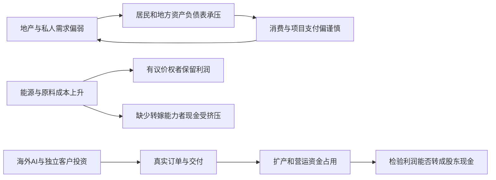

**我的判断是：当前应优先研究成熟电信运营商、资本充足且损失确认充分的银行，以及已有海外销售与现金兑现的全球化制造龙头。成长方向中，电网设备值得优先深挖；低成本油气是必须通过油价回落压力测试的条件机会。商业化创新药、AI光互联和半导体设备具备产业价值，但现有证据不足以把整个板块列为现价最优。**

这个排序综合了生意质量、现金兑现和当前估值，表示研究资源的优先顺序，不是具体买卖或仓位指令。代表公司用于检验行业机制，不能代表全行业均值。本轮尚未完成个股Gate、V50/V5和Price Map。

研究采用吸引子的整体方法论，不代表任何个人观点：描述系统、识别主要矛盾、给路径与路标、找到生态价值、构建适应性策略。用本仓[股票精简框架](/Users/xinquanzhou/Workspace/investment_research_methods/framework/investment_framework_compact.md)约束行业判断，歧义以[canonical](/Users/xinquanzhou/Workspace/investment_research_methods/framework/investment_framework.md)为准。框架动态配置截至9月19日；本报告没有把旧配置当作10月9日行情，也没有修改框架。

资料读取截至10月9日开盘前；行情锚为10月8日收盘。最新完整宏观组合主要是8月经济金融数据、9月PMI，企业主要是2026年中报。研究期间尚未读取9月CPI/PPI，不能用将发布的数据证明成本压力已经解除。

## 一、主要矛盾：国内需求和资产负债表修复偏慢，成本冲击与局部产业扩张同时存在

如果把中国经济看作一个系统，居民、企业、地方财政、金融机构和海外客户并不处于同一个周期。居民收入预期和住房资产影响消费、储蓄与借贷；地方土地收入影响支出和项目支付；企业看订单与资本回收决定扩张；海外AI投资和贸易需求则给部分供应商提供另一套现金来源。

因此，用一个“复苏”或“衰退”标签无法解释现状。**更有解释力的主要矛盾是：国内广泛需求与私人部门扩张意愿偏弱，而能源、原料涨价和少数产业的订单扩张，要求企业继续投入资金。谁能保住现金、把成本转嫁出去、或者获得独立于弱内需的真实订单，谁才可能留住价值。**这是基于下列事实的机制推断。

| 观察 | 已核验事实及期间 | 投资含义 |
|---|---|---|
| 国内需求与投资 | 8月社零同比+0.4%；1—8月民间投资-10.1%、房地产开发投资-19.9%；同期人民币口径出口+14.6% | 内需、地产与出口方向分化；出口额增长不能直接替代数量、毛利或收款。[统计局8月经济发布，M1](https://www.stats.gov.cn/zwfwck/sjfb/202609/t20260915_1965307.html) |
| 生产改善与订单宽度 | 9月制造业PMI50.1；新订单50.5，略低于8月50.6；小型企业PMI48.9 | 总指数回到扩张区间，尚不足以证明广泛需求加速。[统计局9月PMI，M2](https://www.stats.gov.cn/zwfwck/sjfb/202609/t20260930_1965449.html) |
| 价格冲击 | 8月出厂价格同比+3.8%、购进价格+5.8%；生活资料出厂价-0.5% | 价格上涨的受益者与承担者不同，不能把PPI转正等同需求复苏。两指数覆盖不同，2个百分点之差不是企业利润率下降幅度。[统计局PPI原文，M19](https://www.stats.gov.cn/sj/zxfbhjd/202609/t20260909_1965262.html) |
| 利润与现金占用 | 1—8月规上工业利润+15.7%；营收+6.6%，应收+9.0%、产成品存货+11.0% | 总利润并非下降；电子等行业贡献很强，但现金占用增速高于营收，必须检查行业广度和现金兑现。[统计局工业利润，M3](https://www.stats.gov.cn/xxgk/sjfb/zxfb2020/202609/t20260928_1965425.html) |
| 地方财政 | 1—8月土地出让收入-28.6%，地方一般公共预算支出+0.3% | 地产调整可能通过财政与工程支付形成反馈；具体公司是否受损仍需客户和账龄证据。[财政部收支，M5](https://m.mof.gov.cn/czsj/202609/t20260918_3997709.htm) |
| 信用数量 | 1—8月社融增量23.91万亿元，同比少2.64万亿元；住户贷款减少1.03万亿元 | 融资供给存在，不等于私人部门愿意加杠杆。这里读的是新华社转载央行报告，未取得央行官网原页。[金融报告转载，M6](https://www2.xinhuanet.com/fortune/20260914/06447ad39fda407a8da93deb2a607b64/c.html) |

先运行吸引子宏观工具，再核对原始发布。工具给出总需求、内需、信用数量和项目投资偏弱，物价、产能利用趋势偏强的组合。它是方向性综合状态，**不是GDP增速、统计局利润同比或未来概率**；底层权重与观察日期未取得。工具“企业利润转下降”不能覆盖统计局累计利润增长的事实。详细读数与日期在[macro-api.md](/Users/xinquanzhou/Workspace/investment_research_methods/output/deep-research/2026-10-09-china-macro-sector-opportunities/macro-api.md)。

这一轮重点深入三个维度：主体资产负债表之间的反馈、产业价值由谁保留，以及现金收益与市场预期的时间尺度。其余维度——钱货流量、收益来源、脆弱性、均衡与失衡、路标和市场预期——用于检查遗漏，不把模型数量当作证据强度。

### 三条重要的耦合关系

**第一条是地产—财政—私人需求的反馈。** 房地产调整可能压低居民财富感受和地方土地收入，弱支出、慢支付和弱订单又使企业扩张更谨慎。这是一条需要打断的负向循环；它不是对每个地区、企业的已证实因果关系。只有需求、支付和私人投资出现持续改善，才有理由扩大对内需周期行业的乐观假设。

**第二条是投入品涨价—利润分配的反馈。** 对低成本上游生产商，涨价可能形成现金；对缺少议价权的加工企业，同一涨价会吞噬利润。上游赚钱不意味着整个产业链赚钱，更不意味着这一利润能永久持续。

**第三条是局部高景气—扩张—资金占用的反馈。** 订单增长促使公司采购、备货、建厂；利润确认可以先于收款。如果股价同时提前计入数年增长，投资者就承担了经营资金需求和估值压缩两层风险。AI链正适合用这条结构检验。

## 二、把宏观判断翻译为投资框架

宏观判断只负责提高或降低举证要求，最终要落到公司。政策、产业空间和股价动量各有作用，但都不能替代客户付款与资本回报。

1. **R20：明确收入依赖谁。** 国内消费和地产收入占比高、没有真实外需或提价对冲的公司，收入假设从严。电网客户有独立投资预算，全球制造有海外销售，不能把它们一律当作普通消费。境外收入也不自动免疫汇率、关税和客户周期。
2. **R19：政策落地→份额/订单传导→资本回报。** 规划只是第一环；4—8周内须检查第二环。已有早期订单不能反过来证明新政策造成了订单。第三环还要检查利润率、回款和ROIC。
3. **Precheck：利润和现金同时解释。** 使用同期间同比、季节性、存货、应收及应付变化。单个半年OCF低不等于永久失败，但“备货所以不用担心”同样不是证明。
4. **R7/R8：AI逐家公司判断。** 资本开支指引转弱且订单同步转弱才是R7合取条件；R8还要求逐季兑现、订单可见度与合理的2027估值。本轮未取得足够的2027估值闭环，不替全板块宣布通过。
5. **R14/R15：给油价两面。** 下游须检验100→130美元成本压力，上游须检验85美元及以下回落。供给中断带来的利润按供给冲击研究，不能归为需求周期全面反转。
6. **R9及R1：好生意仍须检查价格和拥挤。** R9的利差、公募持仓分位、换手分位三项缺一不给完整买入型Price Map。R1需拥挤、估值分位高且无近端业绩三项同时成立；本轮缺分位，不宣称已触发，也不把缺失当作通过。

估值方法按生意选择：稳定现金业务用正常化PE/PFCF；银行用PB—ROE、信用损失与剩余收益；保险拆营运收益、资本和内含价值；资源用中周期利润；创新药用商业化产品与风险调整管线；设备与AI用交付、现金和估值压缩双情景。不可把同一个PE阈值套到所有行业。

## 三、现价改变了行业顺序

18个A股样本来自本轮Tushare Pro真实API，全部交易日为2026-10-08。PE/PB沿用数据服务口径，未逐家公司重算TTM分母；它们是候选筛查锚，不是行业平均，也不是盈利预测。股息率为税前历史TTM，不能外推未来。[原始快照，M9](/Users/xinquanzhou/Workspace/investment_research_methods/output/deep-research/2026-10-09-china-macro-sector-opportunities/valuation-samples-20261008.json)

| 代表样本 | PE TTM | PB | 历史股息率 | 本轮支持的用途 |
|---|---:|---:|---:|---|
| 中国移动A | 16.13 | 1.50 | 4.81% | 运营商价格参照；该公司官方中报正文未读通 |
| 中国电信A | 19.74 | 1.25 | 3.92% | 将现金创造与报表利润压力配对 |
| 招商银行A | 6.93 | 0.92 | 4.83% | 低倍数与信用、资本约束一起研究 |
| 美的集团A | 14.05 | 2.94 | 5.15% | 现金创造、套保经济实质和正常化盈利 |
| 海尔智家A | 10.66 | 1.59 | 5.65% | 较低价格与利润修复一起验证 |
| 国电南瑞 | 21.86 | 3.53 | 2.73% | 订单增长必须转成利润与回款 |
| 中国海油A | 11.74 | 1.90 | 3.35% | 油价正常化后重算，不能把峰值PE当稳态PE |
| 长江电力 | 19.53 | 3.27 | 3.46% | 优质成熟资产与现价保护分别判断 |
| 中际旭创 | 45.09 | 23.14 | 0.18% | 强增长、现金占用与2027预期匹配 |
| 北方华创 | 76.64 | 10.74 | 0.13% | 国产替代与较高增长负担配对 |

中债同日10年国债名义到期收益率为1.6899%。由上述历史股息率相减，招行约3.14个百分点、中国移动约3.12、美的约3.46、长电约1.77。这只是税前静态利差，未扣税费、未做未来分红预测，也没有历史利差分位。公募持仓和换手历史分位仍缺，**红利护栏未完成**。[中债官方曲线，M23](https://yield.chinabond.com.cn/cbweb-pbc-web/pbc/more?locale=cn_zh)

框架Terminal参数为A股r=8%、g=2%、N=7、K≈0.10，港股r=10%、g=2%、N=7、K≈0.16。机械筛查下，中际K×PE≈4.51，北方华创≈7.66，南瑞≈2.19。它提醒我们检查终局盈利负担，**不等于市场真的预测了这些倍数，也不是完整DCF的公平价值**；尚需计入期间现金、再投资、份额、利润率和资本结构。

再做一个纯算术压力情景：若可持续盈利增加30%，PE从45倍降到30倍，价格变化约为1.3×30/45−1=−13.3%，未计分红。这不是预测，却解释了为何产业增长很强仍可能带来较差的股票回报。

## 四、哪些行业值得优先研究

| 层次 | 行业与应找的生态位 | 当前判断 | 最关键的下一道验证 |
|---|---|---|---|
| 优先 | 成熟电信运营商的基础连接业务 | 重复需求、既有网络与客户规模支持现金分配；研究价值优先于单纯AI叙事 | 维护与新增capex、报表利润、分红是否持续由现金覆盖 |
| 优先 | 资本充足、信用损失确认充分的银行 | 价格端较有保护，适合在弱内需环境中研究风险是否已充分计价 | 息差、零售信用成本、正常化ROE及资本可分配量 |
| 优先 | 已有海外品牌、渠道与回款的制造龙头 | 真实外需与现金提供对冲；美的等值得完整估值 | 套保经济口径、海外终端库存、毛利与现金来源 |
| 成长重点 | 电网调度、保护、柔直及关键输配电设备 | 需求证据较强；优先高附加值系统能力，谨慎低毛利总包 | 合同转交付、采购付款与回款、产品毛利/ROIC |
| 条件机会 | 低成本油气上游 | 现金兑现已有证据，能受益于供给紧张；价格仍依赖正常化利润 | 85美元及以下油价、资本开支、储量替代和分红压力 |
| 有选择的成长观察 | 已商业化创新药 | 产品收入比授权标题更能支撑价值；不能把整条管线概率视为1 | 剔除合作预收款后的现金、产品竞争、风险调整估值 |
| 严格验证 | AI光互联、先进半导体设备/材料 | 产业需求与技术壁垒存在，强业绩不自动抵消现金占用和高估值 | 2027订单与估值、技术结构、收款、持续资本回报 |
| 次序靠后 | 成熟水电、保险、扩建核电等 | 各有好生意，但价格保护、会计口径和建设期现金不能混为一谈 | 官方原文缺口、资本/债务服务和股东可分配现金 |

### 1. 运营商：把连接业务和新增投资分开

中国电信中报OCF613.75亿元，管理口径自由现金流289.27亿元；报表归母利润195.88亿元，低于上年230.17亿元。管理口径capex与现金流表购建支出不同，不混算。公司披露增值税分类范围调整影响；“可比增长”不能抹去报告利润下降。[中国电信中报，M13](https://www.chinatelecom-h.com/en/ir/report/interim2026.pdf)

价值留在规模网络、客户关系和持续付费上，但监管和技术迭代也会改变利益分配。运营商的吸引力依赖资本开支纪律，若新增云/AI项目投入持续增加而客户付费不足，研究顺序就要下降。中国移动用于现价样本，官方中报读取缺口保留，不借其他运营商财务替它作个股裁决。

### 2. 银行：低估值是起点，损失吸收能力决定是否成立

招行中报净息差1.83%，同比下降5bp；ROE13.42%，也较上年同期下降；不良率0.94%、拨备覆盖385.10%。这些数字支持研究其缓冲能力，也提示盈利质量仍有压力。[招行正式中报摘要，M14](https://static.cninfo.com.cn/finalpage/2026-08-29/1225530235.PDF)

为什么弱需求中还研究银行？因为股票回报取决于实际损失与价格已经隐含的损失之差。存款、结算和客户生态可以创造价值，但地产、零售贷款的滞后损失可能把低PB变成合理折价。用资本和信用成本检验分红，不套工业企业OCF；需要补读完整母公司分配及资本规划，不能据摘要宣布所有门槛通过。

### 3. 全球化制造：先看现金与真实地区收入

美的中报归母利润增长1.66%，OCF375.52亿元、增长0.73%；扣非利润下降25.31%。报告解释外币汇兑损失与相应衍生工具收益分别进入经常/非经常项目，因此须合并经济敞口分析，不能把扣非降幅直接称为主业崩塌。[美的中报，M22](https://disc.static.szse.cn/disc/disk03/finalpage/2026-08-29/df25443f-d67a-4cc5-8bd6-6c3e681a9575.PDF)

海外品牌、渠道和本地运营有机会获得长期价值，但必须用已经产生的收入与现金证明。海尔中报归母利润下降14.27%、OCF下降12.45%，说明出口/全球化标签不足以豁免盈利压力；约10.66倍PE让它值得做修复估值，却不能单凭低倍数提高到确定性最高。[海尔中报，M16](https://static.cninfo.com.cn/finalpage/2026-08-28/1225522691.PDF)

工程机械同属可研究方向，但有较强周期、经销商库存和套保口径约束。它与品牌家电不是一个可不加区别的行业篮子。机器人等尚未转成重大现金的选项，本轮不额外给估值溢价。

### 4. 电网设备：需求较清楚，价值能否被供应商保留仍待检验

国家能源局披露上半年电网重点项目投资增长13.5%。南瑞新签合同增长28.79%，归母利润仅增长4.08%，OCF下降78.95%；公司解释主要为采购付款增加。这是需求证据与兑现约束同时存在。[能源局，M25](https://www.nea.gov.cn/20260730/6c60113d8ba5471eb0045cb7b314dee8/c.html)、[南瑞中报，M20](https://static.cninfo.com.cn/finalpage/2026-08-27/1225508099.PDF)

优先找有运行可靠性、控制算法、认证与系统集成经验的环节，而不是只按投资总额选择所有设备商。订单不自动成为高毛利，低毛利储能或EPC也可能放大收入却消耗营运资金。工程回款有季节性，应看同期间同比及全年收现；本轮没有用半年OCF硬否决，也没有以季节性抹去反证。最新官方分批中标份额仍缺。

### 5. 油气：现金真实，周期也真实

中国海油中报OCF1416.31亿元，现金购建长期资产533.75亿元，简单差额882.56亿元；它是现金筛查代理，尚未扣尽租赁等股东索取。公司披露完全成本29.7美元/BOE，这不是油价盈亏平衡点。[海油中报，M10](https://www.cnoocltd.com/english/investorrelations/reports/interimreport/202609/P020260908577972290064.pdf)、[业绩发布，M11](https://www.cnoocltd.com/english/presscenter/pressreleases/2026/202608/t20260826_122439.html)

EIA10月6日展望预测2026Q4布油105美元、2027年84美元；这些是模型预测，并非现价或保证。[EIA最新展望，M8](https://www.eia.gov/outlooks/steo/report/index.php) 因此，框架85美元回落检验有现实意义：要重新计算实现油价、产量、税费与资本开支下的利润和现金。只有回落后仍有资本回报与价格保护，才值得提升优先级。本轮尚未完成该个股模型，不用11.74倍峰值附近PE证明便宜，也不把判断推广到黄金、煤炭或航运。

### 6. 创新药：商业化产品与研发期权分别估值

信达中报产品收入82.01亿元、增长56.7%；OCF35.88亿元中包含合同负债增加21.27亿元。礼来3.5亿美元首付款已收到，但6月末仍列合同负债、尚未确认收入。全部合同负债增量扣除后的14.61亿元仅为敏感性代理，不能称纯产品OCF。[信达完整中报，M21](https://www1.hkexnews.hk/listedco/listconews/sehk/2026/0929/2026092900476.pdf)

真正的生态价值来自临床差异化、商业化能力与权益保留。授权可以降低资金风险，却不能把最高里程碑金额当现值；国内产品销售也不等于已成为海外制药龙头。应采用“产品现金流+逐管线风险调整价值−未来研发义务”的估值。本轮未取得候选港股现价及完整风险调整估值，故不列入当前价格保护最强的一档。

### 7. AI与半导体：有强业绩，仍须检验现金和终局

微软FY2026第四财季资本开支410亿美元、经营现金流554亿美元；公司表示FY2027资本开支预计增长。这支持海外投入仍强的研究背景，但指引是管理层预期，资本开支也包含建设和租赁，不能按比例映射国内供应商收入。[微软官方电话会，M26](https://www.microsoft.com/en-us/investor/events/fy-2026/earnings-fy-2026-q4)

中际中报归母利润136.51亿元，OCF约18.00亿元，现金购建长期资产48.02亿元。合并净利润口径的OCF转化约12.21%，与归母口径约13.18%分别标注；存货与经营性应收占用了现金。扩张备货是公司解释，不是坏账已发生的证明。[中际中报，M12](https://disc.static.szse.cn/disc/disk03/finalpage/2026-08-22/037d5232-a9bd-4ec3-a28e-e446195d65d9.PDF)

技术结构还会改变价值保留：英伟达5月声明Spectrum-X CPO交换机已进入生产，这是厂商的量产声明；它提高了产品结构变化的研究必要性，但没有证明可插拔光模块需求消失。[英伟达原文，M24](https://nvidianews.nvidia.com/news/vera-rubin-full-production-agentic-ai-factory) 因此不能只按总带宽增长外推既有产品的单位利润。

北方华创中报营收增长24.90%，归母增长5.05%，OCF改善至37.74亿元。技术验证与国产替代有意义，但约76.64倍PE要求未来盈利和资本回报提供更强证明。[北方华创中报，M17](https://disc.static.szse.cn/disc/disk03/finalpage/2026-08-26/5b947dae-f3ad-4009-8874-248e9abff0fd.PDF) 设备、材料、服务器、液冷、存储不能互相代替证据；没有当前合同价和个股现金闭环的子链，保留观察。

### 8. 为什么没有把所有红利与公用事业放在第一档

成熟水电的资源和运行资产有价值，但19.53倍PE与3.46%历史股息并不能自动形成价格保护；长电官方中报正文本轮读取失败，二手转载数字未用于一级排序。扩建核电更要分开：中广核中报OCF133.32亿元、现金购建268.14亿元，成熟机组现金与集团建设支出并非同一回事。[中广核中报，M15](https://static.cninfo.com.cn/finalpage/2026-08-26/1225503731.PDF) 中国核电报价不与中广核财务拼接。

保险需拆营运利润、投资收益、资本和上划现金。平安中报投资收益假设下降50bp的EV敏感性约−9.6%，是模型情景，不是当期实际EV下降。[平安中报，M18](https://group.pingan.com/resource/pingan/IR-Docs/2026/pingan-interim26-results.pdf) 这些约束使低PE保险、区域公用事业和扩建核电都不能靠行业名称直接进入第一档。

## 五、三条路径与可以改变判断的路标

以下置信度是证据支持程度，未分配伪精确概率。

| 路径 | 当前支持程度 | 可观察路标 | 对研究顺序的影响 |
|---|---|---|---|
| 基准：弱内需与局部产业扩张延续 | 较高；当前需求、投资和企业分化同时支持 | 社零与私人信用持续偏弱；成本传导不充分；高景气订单尚在但收现分化 | 现金与资本纪律继续优先；电网/AI逐家公司通过兑现验证 |
| 改善：内需与信用回升、成本压力缓和 | 中低；PMI改善是一条线，尚缺广度 | 框架D8要求9月社零>2%且单月新增贷款同比不少增后复核；另看购进/出厂价差、后续订单与回款连续改善 | 扩大国内消费、制造和周期修复的估值研究；单条路标不够改变全局 |
| 压力：成本高位持续、外部金融紧、订单或收款转弱 | 有现实风险；严重程度不确定 | 高油价与实际毛利受损并存；资本开支指引和在手订单同步走弱；信用成本/融资需求上升 | 提高现金安全垫要求，收紧终局假设；已有强业绩不能免除估值压缩测试 |

美联储9月16日将目标区间提高到3.75%—4.00%，说明不能假设海外降息自然帮助高估值成长。[美联储决议，M7](https://www.federalreserve.gov/newsevents/pressreleases/monetary20260916a.htm) 但本轮没有核实框架列示的全部点阵图、美债现价和市场隐含降息，不能仅凭旧状态宣布全市场冻结。

接下来的有效路标集中在三类：9月价格与经济金融数据；三季报的利润率、营运资金和现金；海外客户资本开支、交付和技术结构更新。正式报表与原始合同优先于预告、管理层乐观表述和股价涨跌。

## 六、如何使用这个结论

先对第一档做正常化盈利与资本回报估值，再研究电网和商业化创新药的成长是否留下足够价格余量。油气同时算高油价和85美元回落，AI同时算盈利增长和倍数收缩。每个方向都设证据失效条件：现金长期依靠应付扩张、信用损失增加、订单递延、产品结构改变或资本开支回收延长，均应重做判断。

从吸引子视角看，这样做的目的，是让判断能随路标变化，不把一种宏观叙事锁成唯一未来。Carry来自可持续分配，价值来自价格低于保守的未来现金，动量来自市场自我强化；三种收益来源应分开解释，不用动量证明长期价值。

**咱们现在最该找的，是在这个分化系统里能够持续收钱、保住资本回报，而且股价没有把未来提前花完的公司。**

## 证据边界与本地交付

- 行业研究已完成；个股执行信息仅部分完成。未完成完整Gate、治理/筹码审查、前瞻分红、2027估值、V50/V5或Price Map，本文不能声称个股已通过全部门槛。
- 港股报价API返回频率上限，本轮未取得同日港股价格。香港上市企业的生意证据可用，当前A/H相对便宜、税后股息与币种比较保持未验证。
- 缺公募持仓、板块换手及估值历史分位；没有据一次换手率推断拥挤，也未核验国家队连续减持。
- 样本为机制取证，不是全市场穷尽筛选。没有完整覆盖地产、汽车、光伏、电池、食品饮料等所有行业，未覆盖不能被解释为已经否决。
- OCF减现金购建支出只是筛查代理，未扣全部租赁、并购、少数股东等现金要求；银行保险不适用该机械计算。半年数据保留季节性和营运资金解释。
- 正式报告关键事实由主代理直接复核对应原文；同一财报被多个代理读取不算独立多源验证。读取为关键章节文本，不宣称逐页视觉审计。
- [单一来源索引](/Users/xinquanzhou/Workspace/investment_research_methods/output/deep-research/2026-10-09-china-macro-sector-opportunities/sources.md)、[输入交接及冲突裁决](/Users/xinquanzhou/Workspace/investment_research_methods/output/deep-research/2026-10-09-china-macro-sector-opportunities/handoff.md)、[计算记录](/Users/xinquanzhou/Workspace/investment_research_methods/output/deep-research/2026-10-09-china-macro-sector-opportunities/calculations.json)随报告保存。三组独占行业笔记记录扩大取证和未决项，不替代本报告。
- 本次仅本地研究与保存，未交易、未推送Git、未创建PR、未对外发消息。
